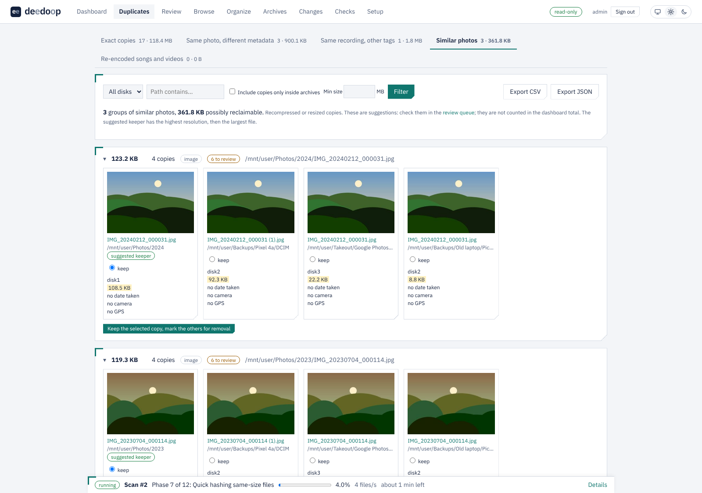

<h1>
  <picture>
    <source media="(prefers-color-scheme: dark)" srcset="docs/images/deedoop-wordmark-dark.svg">
    
  </picture>
</h1>

**Dedupe your hoard, safely.**

deedoop finds the duplicates other tools miss on your Unraid server: identical files with different names, photos that differ only in their metadata, re-compressed copies, and the contents of Google Takeout zips you've already got on disk. It indexes your terabytes incrementally, one disk at a time, and shows you everything before touching a single file.

## Screenshots

<p>
  
  
</p>
<p>
  
  
</p>

## Status: milestone 8

deedoop finds **exact duplicates of any file type**, **photos that differ only in their metadata**, **similar photos** (recompressed or resized copies, which you review) and **songs and videos that are the same recording with other tags** or **re-encoded copies** (which you review), looks **inside zip, tar and 7z archives and Google Takeout**, reports what it finds, **plans reorganisations** you can preview, and, once you allow it, **removes duplicates and applies plans** with a quarantine and undo. It is **read-only by default**: nothing changes until you sign in as the admin, turn on changes in Setup, mount `/mnt` read-write, and confirm each list of changes. Signed out, deedoop can only be looked at, never changed.

| Milestone | What it adds | Status |
|---|---|---|
| M1 | Exact duplicates, any file type, report only | done |
| M2 | Photos that differ only in metadata (EXIF-blind image hash), metadata, Browse | done |
| M3 | Zip/tar/7z members and Google Takeout coverage ("what's already on disk"), local CI | done |
| M4 | Similar photos (recompressed, resized, "Storage saver") with a review queue | done |
| M5 | Browse and plan reorganisation (preview only) | done |
| Gate | Write access to `/mnt` is turned on only with your OK | done |
| M6 | Move and delete: quarantine with undo, opt-in direct delete, hardlinks, apply plans | done |
| M6.5 | Hardening and sign-in: read-only unless signed in, CSRF, security rules enforced in CI | done |
| M7 | Video and audio: ffprobe details, "same recording, other tags", music view; scanners you can turn off | done |
| M7.5 | Built-in HTTPS; scan progress with phase x of y, start time and ETA; scan log | done |
| M8 | Re-encoded songs and videos (audio and video fingerprints) with a review queue | this release |

## What it does

- **Setup screen.** Lists your Unraid shares, disks and pools. Tick the shares to scan, add other folders (for example on an unassigned device), set exclusions, the disk mode and a nightly schedule.
- **Reads the disks, not `/mnt/user`.** A share is scanned as its folder on each disk (`/mnt/disk1/Photos`, `/mnt/disk2/Photos`, …), so every file knows its disk, and the report still shows the `/mnt/user/...` path you know.
- **One disk at a time by default.** Only one array disk works at once. A parallel mode reads several disks at once, and a **benchmark** measures each disk alone and in combinations, plus hashing speed, and proposes the setting.
- **Lazy, tiered hashing.** Files are grouped by size; only same-size files get a quick hash (first and last 64 KB); only those that still match get a full BLAKE3 hash. Files with a unique size are never opened.
- **Incremental index.** A SQLite index in `/config` remembers size, mtime and inode. A rescan walks folders and rereads only new or changed files. Stopped scans pick up where they left off.
- **Honest numbers.** Hardlinks are recognised as one copy and never counted as wasted space. Empty files are ignored.
- **Report.** Duplicate groups sorted by reclaimable space, filters by type, disk, path and size, and CSV or JSON export.
- **Same photo, different metadata** (milestone 2). JPEGs are compared on their compressed image data with EXIF, XMP, IPTC, ICC, embedded thumbnails and comments skipped; PNG, HEIC/HEIF, WebP, AVIF, TIFF and BMP are compared on their decoded pixels. A date fix, a GPS tag or a photo manager's keywords no longer hide a copy. The report shows both photos side by side with the fields that differ highlighted. Recompressed or resized copies (Google "Storage saver") are covered by similar photos, below.
- **Metadata** (milestone 2). ExifTool reads date taken, camera, resolution, duration and GPS from photos and videos, headers only.
- **Browse** (milestone 2). Walk a share as one folder tree across its disks, as a list or as thumbnails, and filter by type, year taken, camera, missing GPS, missing date or duplicates only. Each file has a details page with its metadata, hashes and duplicate groups. Thumbnails are made on demand and cached in `/config/thumbs`.
- **Archives and Google Takeout** (milestone 3). Zip, tar (also .tar.gz, .tgz, .tar.bz2, .tar.xz) and 7z files in your Takeout folders, or in every scanned folder if you turn that on, are read in place: nothing is extracted to disk. Each file inside is hashed like a loose file, so it joins the duplicate report, and an archive inside an archive is opened one level deep. The **Archives** screen shows, for every archive and every album in it, how much is already on your disks (byte for byte, or the same photo with other metadata), what exists only in another archive, and what is not on disk yet, with previews. The parts of a multi-part Takeout (`takeout-…-001.zip`, `-002.zip`, …) are shown as one, and Google's JSON sidecars are matched to their photos across parts, including the truncated and `(1)` names Google produces, to give each photo its date taken and GPS. Copies inside archives never count as reclaimable space, because they can't be removed on their own; tick "Include copies only inside archives" on the Duplicates screen to see them.
- **Similar photos** (milestone 4). Every photo, loose or inside an archive, gets two 64-bit perceptual hashes (pHash and dHash) computed on a small greyscale copy with its EXIF rotation applied, so a Google "Storage saver" copy, a resized export or a re-saved JPEG still matches its original. Close pairs are found with multi-index hashing, which takes roughly one to two minutes per million photos. The **Review** screen shows each pair side by side with the fields that differ highlighted, the distance, supporting hints (same date taken, same shape, same name) and a suggested keeper (highest resolution, then largest file, then earliest date). Answer with the keyboard: **K** keep left, **J** keep right, **B** same photo but keep both, **N** not the same photo, **S** decide later. Decisions are stored against the photos' image data, so they survive rescans, renames and moves, and a pair marked "not the same photo" never comes back. Nothing is moved or deleted; the decisions are used by milestone 6. Similar matches are suggestions and are not counted in the reclaimable total. The match closeness (0 to 10, default 8) is set on the Review or Setup screen. In the Archives screen, Takeout photos that exist on disk only as a similar copy are counted apart.
- **Plan a reorganisation** (milestone 5). From any folder or filtered search in Browse, choose **Reorganize these files** and write a move rule such as `Photos/{year}/{month}/{name}` (tokens: `{name}`, `{stem}`, `{ext}`, `{year}`, `{month}`, `{day}`, `{date}`, `{camera}`, `{folder}`, `{parent}`, `{share}`; presets included). The preview shows where every file would go and sorts them into: will move, will copy (a device outside the array), renamed because the name is taken (`name (1).jpg`), already in place, already there with the same content, conflicts and skipped, with a count per destination folder. Dates come from EXIF or the Takeout JSON; photos without one go to an `Undated` folder, use their modified date, or stay put, as you choose. Moves are **disk-aware**: a file on disk2 going to another share stays on disk2 (`/mnt/disk2/Backups/…` → `/mnt/disk2/Photos/…`), a rename that copies nothing and fills no other disk, and a name already used on any disk of the share counts as taken. Save a plan to keep the list of moves, check it again later against the index (files that changed since are marked) and export it as CSV. **Nothing is moved**: milestone 6 applies saved plans after you confirm.
- **Remove duplicates and apply plans** (milestone 6). Off until you tick **Allow changes** on the Setup screen *and* give the container read-write access to `/mnt`; the header shows which. In **Duplicates**, pick the copy to keep in each group (the suggested one is preselected), or mark every group shown by your filters at once, keeping the suggested, oldest, newest or shortest-path copy, or the one whose path contains some text. "Keep left / right" decisions from **Review** are added with one click. Everything you mark lands on the **Changes** screen, with the kept copy shown under each file, and nothing happens until you confirm there. Removals go to a **quarantine** by default: the file is renamed into a hidden `.deedoop-quarantine` folder inside the same share folder on the same disk, so it is instant, copies nothing and creates no Unraid share. Exact copies on the same disk can instead be **replaced with a hardlink** to the kept copy. **Delete permanently** is opt-in and asks you to type DELETE. Just before touching each file, deedoop checks it again: unchanged since the scan, the kept copy still there and not the same file, and for exact copies both are read and hashed again (for "same photo, other metadata", both images are compared again). Anything that fails a check is skipped with the reason. A saved **plan** is applied from its page: files on the same disk are renamed, files from another device are copied, verified and the original goes to quarantine, and a destination that became taken is skipped. Every change is journaled: **Undo** puts files back, **Empty quarantine** deletes them for good, and quarantined files are deleted automatically after 30 days (configurable, or never). The quarantine is never scanned.
- **Sign-in and read-only mode** (milestone 6.5). One admin account. Signed out, deedoop never changes anything: every change (files, marks, review decisions, plans, settings, scans) needs the signed-in admin. An admin switch decides what signed-out visitors see: just the scan status and the sign-in form (the default), or every page read-only. On first start, the admin is created with a one-time **setup code** from the container log, so nobody else on your network can claim it. Passwords are hashed with Argon2id; sessions are cookies that expire after 8 hours idle or 7 days; five wrong passwords lock that address for 15 minutes (doubling each time), without locking you out from your other devices. Turning on changes or permanent delete, permanent delete and emptying the quarantine ask for the password again after 10 minutes. Setup shows a security log of sign-ins and changes. See [SECURITY.md](SECURITY.md).
- **Scanners you can turn off** (milestone 7). Exact copies are always found. Photos, videos, music and audio, and archives are each a scanner with its own switch on the Setup screen. Turn one off and its scan steps are skipped and its duplicate groups and marks are dropped straight away; turn them all off and deedoop compares raw file contents only. A scanner whose tools are missing from the container says so and is skipped.
- **Videos and music** (milestone 7). ffprobe reads every video and song's headers: duration, codecs, resolution, frame rate, bitrate, channels, sample rate and, for music, artist, album, title, track, year, genre and cover art. Files that share a stream layout and a length with another file, and aren't already plain exact copies, get a **stream hash**: a hash of their compressed audio and video packets with tags, cover art, chapters and the container left out (`ffmpeg -c copy -f streamhash`). The new **Same recording, other tags** method on the Duplicates screen groups a song retagged by a music manager, a FLAC with new album art, a phone video whose date was fixed or an MKV remuxed to MP4, with the fields that differ highlighted. These copies are bit-for-bit the same recording, so they count towards reclaimable space; the suggested keeper has the most complete tags. Removing one reads both files again and checks that the streams still match. In **Browse**, filter by artist, codec and length, open the **Music** view (artists, then albums and tracks), and play songs and videos on their file page. Broken or unusual files keep their exact-copy matching and show the reason on their page.
- **Scan progress and log** (milestone 7.5). The status card shows when the scan started, how long it has run, which phase it is in (**phase 3 of 7**, with a bar for the whole scan), how far that phase is in files or bytes and a rough **time left for the phase**, counting only time spent working (pauses are left out). While deedoop walks folders, the total is the last scan's file count. Later phases depend on what earlier ones find, so there is no ETA for the whole scan. The **scan log** (Dashboard > Full log) lists each phase with its duration, the files to read, and every file or folder that could not be read, for the last 30 jobs; filter it to warnings and errors. The last few lines also show under the status card while a scan runs.
- **Built-in HTTPS** (milestone 7.5). Off by default. Set `DEEDOOP_HTTPS=on` and deedoop serves HTTPS on its usual port: with your certificate if you put `cert.pem` and `key.pem` in the `tls` folder of its appdata, otherwise with a self-signed certificate it makes on first start (browsers warn once per device; the Setup screen shows the fingerprint to check). A certificate that cannot be used falls back to the self-signed one, and Setup says why. TLS 1.2 and 1.3 only. For access from outside your home, a reverse proxy with a real certificate is still the better choice.
- **Re-encoded songs and videos** (milestone 8). A song converted from FLAC to MP3, a video shrunk by a phone or re-encoded by Plex are not the same bytes or the same streams, so deedoop fingerprints what they sound and look like. Songs of 10 seconds or more get an audio fingerprint of their first 2 minutes (Chromaprint, the AcoustID algorithm, built into ffmpeg); videos of 1 second or more get a 64-bit pHash of 12 frames spread over their length, with near-blank frames left out. Songs match when their lengths are within 3 seconds and their fingerprints agree on at least 85% of bits at the best offset; videos match when their lengths are within 20% and at least 60% of frames are within 10 bits of each other, allowing a shift of one frame. The **Review** screen has a **Songs and videos** queue like the photo one: both copies with players, the fields that differ highlighted, the match strength and a suggested keeper (lossless first, then the higher bitrate or resolution, the longer length, then the more complete tags). Answer with **K**, **J**, **B**, **N** or **S**; decisions are stored against the fingerprints, so they survive rescans and moves. The Duplicates screen lists them as **Re-encoded songs and videos**. They are suggestions and are not counted in the reclaimable total; "Keep left / right" decisions join the Changes screen with the photo ones. Turn it off with **Find re-encoded songs and videos** in Setup. Heavily trimmed videos that change quickly may be missed, because frames are taken at the same fractions of each length.
- **Light and dark themes.** Follows your system setting, or pick Light or Dark in the header; the choice is remembered per browser.
- **Checks.** Files that exist at the same path on two disks (Unraid shows only one of them in `/mnt/user`), and files that could not be read.

## Install on Unraid

deedoop is not in Community Applications yet, and its image is private: install it from the template in this repo. **[docs/install-unraid.md](docs/install-unraid.md)** has every step, including signing the server in to `ghcr.io` with a read-only token, updating and removing. In short:

1. On github.com, create a **classic** personal access token with only the `read:packages` scope (fine-grained tokens do not work with ghcr.io; 90 days expiry is plenty).
2. In the Unraid terminal, `docker login ghcr.io` with your GitHub login and that token.
3. Still in the terminal, `docker pull ghcr.io/steverodrigue/deedoop:latest`.
4. Still in the terminal, copy [`unraid/deedoop.xml`](unraid/deedoop.xml) to `/boot/config/plugins/dockerMan/templates-user/my-deedoop.xml`.
5. In the web UI's Docker tab, click **Add Container**, pick **deedoop**, check the paths and click **Apply**.
6. Open the container's **Logs** and copy the setup code, then open `http://<server>:8080` (`https://` if you turned on HTTPS), enter the code and create the admin account. (Or set **Admin password (first run only)** in the template.)
7. Go to **Setup**, tick your shares, then start a scan from the **Dashboard**. The first scan reads every file once and can take many hours, even days, on a large array; it runs in the background and can be paused. Later scans only read new and changed files.

The template maps:

| Container | Host | Mode |
|---|---|---|
| `/mnt` | `/mnt` | **read-only** (set it to read/write to allow changes; see below) |
| `/config` | `/mnt/user/appdata/deedoop` | read-write (index database) |
| `8080` | `8080` | web UI |

To let deedoop remove duplicates or apply plans, edit the container, set the `/mnt` path's access mode to **Read/Write - Slave**, then sign in and tick **Allow changes** on the Setup screen. Both are needed; until then deedoop cannot change a file.

The container runs as `nobody:users` (99:100) with a read-only root filesystem, no Linux capabilities and `no-new-privileges`. Forgot the admin password? From the Unraid terminal: `docker exec -it deedoop deedoop reset-password`. For HTTPS on your network, set **HTTPS** to `on` in the template (see Configuration). For access from outside your home, use a VPN or a reverse proxy with HTTPS and set **Trusted proxies**; see [SECURITY.md](SECURITY.md).

**Upgrading from 0.6.0 or earlier:** if you had set the old **Password** (`DEEDOOP_PASSWORD`), it becomes the admin password (user name `admin`) on the first start; then remove the variable. Basic auth is gone.

The image is built by GitHub Actions and published to `ghcr.io/steverodrigue/deedoop:latest` and `ghcr.io/steverodrigue/deedoop:<version>` on every push to `main`. To build it yourself:

```sh
docker build -t deedoop .
docker run -d --name deedoop -p 8080:8080 --user 99:100 \
  --read-only --tmpfs /tmp --cap-drop=ALL --security-opt=no-new-privileges \
  -v /mnt:/mnt:ro,rslave -v /mnt/user/appdata/deedoop:/config deedoop
```

See [`docker-compose.yml`](docker-compose.yml) for a Compose example.

## Configuration

| Variable | Default | Meaning |
|---|---|---|
| `DEEDOOP_CONFIG` | `/config` | Where the index database lives |
| `DEEDOOP_MNT` | `/mnt` | Where the host's `/mnt` is mounted |
| `DEEDOOP_PORT` | `8080` | Web UI port |
| `DEEDOOP_ADMIN_PASSWORD` | (none) | First run only: creates the admin (user name `admin`). Ignored once an admin exists |
| `DEEDOOP_TRUSTED_PROXIES` | (none) | Comma-separated reverse-proxy addresses or networks whose `X-Forwarded-For`/`-Proto` headers are believed |
| `DEEDOOP_HTTPS` | `off` | `on` serves HTTPS on the web UI port instead of HTTP |
| `DEEDOOP_TLS_CERT`, `DEEDOOP_TLS_KEY` | `/config/tls/cert.pem`, `/config/tls/key.pem` | Your certificate (with any intermediates) and its key. If missing or unusable, deedoop uses a self-signed certificate in `/config/tls/self-signed.*` |
| `DEEDOOP_TLS_NAMES` | (none) | Comma-separated extra host names and IP addresses for the self-signed certificate, for example `tower.local,192.168.1.10` |

With HTTPS on, open deedoop with `https://`; plain `http://` on the same port does not answer. On Unraid, also change the template's **WebUI** link to `https://[IP]:[PORT:8080]/`. The self-signed certificate is valid for about 13 months and is renewed on a container restart within its last 30 days. deedoop does not send HSTS: with a self-signed certificate it would make the browser warning impossible to pass.

Everything else is set in the app on the Setup screen.

## Development

```sh
python -m venv .venv && . .venv/bin/activate
pip install -e '.[dev]'   # also install ExifTool and ffmpeg, e.g. apt install libimage-exiftool-perl ffmpeg
DEEDOOP_CONFIG=./data DEEDOOP_MNT=/path/to/test/mnt python -m deedoop
```

### Local CI

`make ci` runs exactly what GitHub runs on every pull request, and needs only Docker:

1. **Lint and tests** in the Dockerfile's `test` stage, on the same Debian and ExifTool as the image, as a non-root user like on Unraid. Ruff includes the bandit security rules (`S`) and a list of banned functions (`TID251`) that enforce the [secure coding rules](docs/secure-coding.md).
2. **pip-audit** of the hash-pinned `requirements.lock` (also `make audit`).
3. **Image build** (`deedoop:ci`).
4. **Trivy** scan of the image for known High and Critical vulnerabilities with a fix.
5. **Smoke test**: starts the image locked down (read-only root filesystem, no capabilities) with an empty read-only `/mnt`, loads every page, and checks the security headers, that a signed-out change is refused, that it runs as uid 99 without pip, and that the setup code is in the log.

`make check` is the quick version: ruff and pytest with the Python on your machine, no Docker. GitHub's workflow (`.github/workflows/ci.yml`) calls `make ci` too, then pushes the image on `main`; CodeQL runs on every pull request and weekly. After changing dependencies in `pyproject.toml`, run `make lock` and commit `requirements.lock`. Contributors (and AI agents, see [CLAUDE.md](CLAUDE.md)) follow [CONTRIBUTING.md](CONTRIBUTING.md).

Layout: `deedoop/scanners.py` (the scanner registry and its switches), `av.py` (ffprobe and ffmpeg), `media_index.py` (video and audio phases and groups), `deedoop/discovery.py` (disks, shares, roots), `scanner.py` (directory walk), `hashing.py` (partial and BLAKE3 hashes), `imaging.py` (metadata-blind image hash, thumbnails), `metadata.py` (ExifTool), `archives.py` (reading zip, tar and 7z members, Takeout sidecars), `archive_index.py` (storing members, sidecar pairing, coverage), `similar.py` (perceptual hashes, similar pairs, review decisions), `engine.py` (scan pipeline and grouping), `benchmark.py`, `worker.py` (job queue and schedule), `changes.py` (removals and moves), `safepath.py` (the only file changes on `/mnt`), `limits.py` (archive limits), `auth.py` (accounts, sessions, throttling), `web/` (FastAPI, Jinja and htmx UI; `web/security.py` is the sign-in, CSRF and headers guard).

## Licence

Apache License 2.0. See [LICENSE](LICENSE) and [NOTICE](NOTICE).
