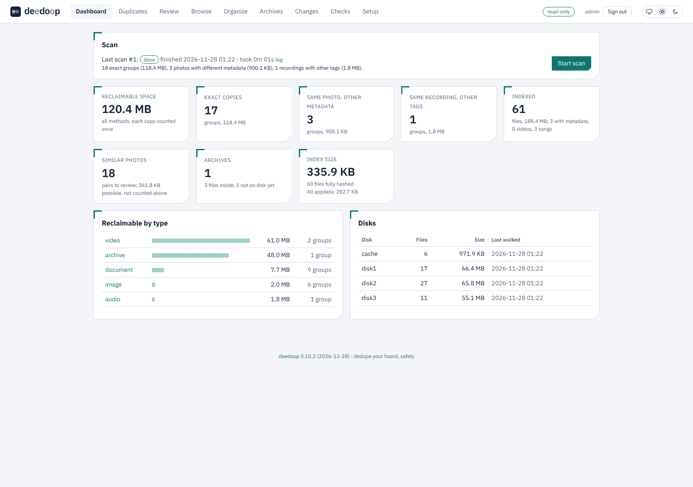
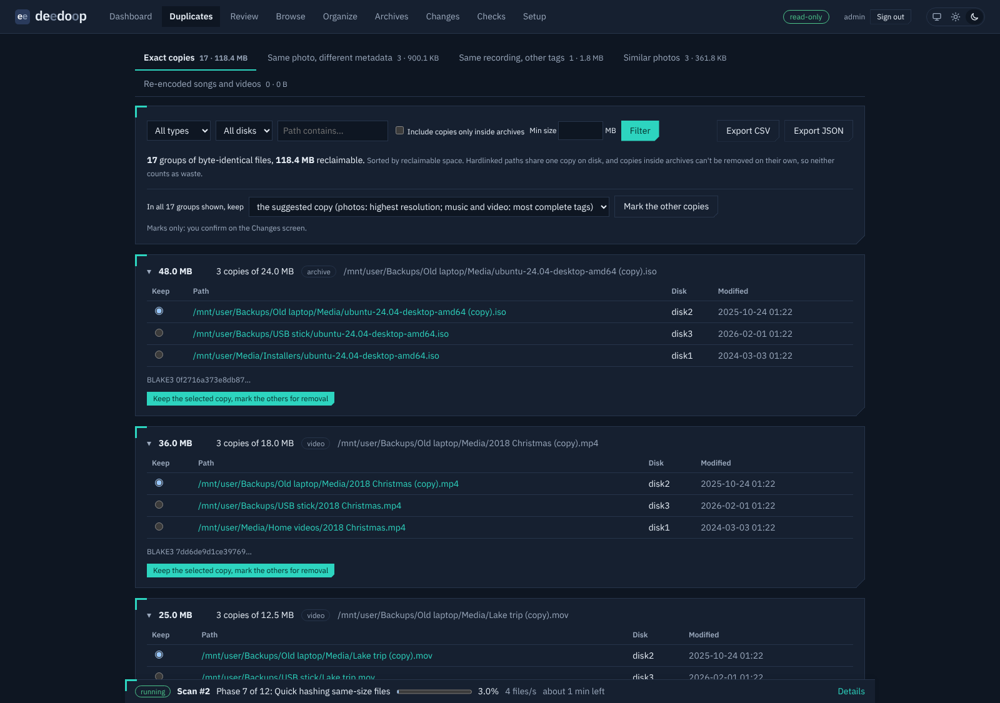
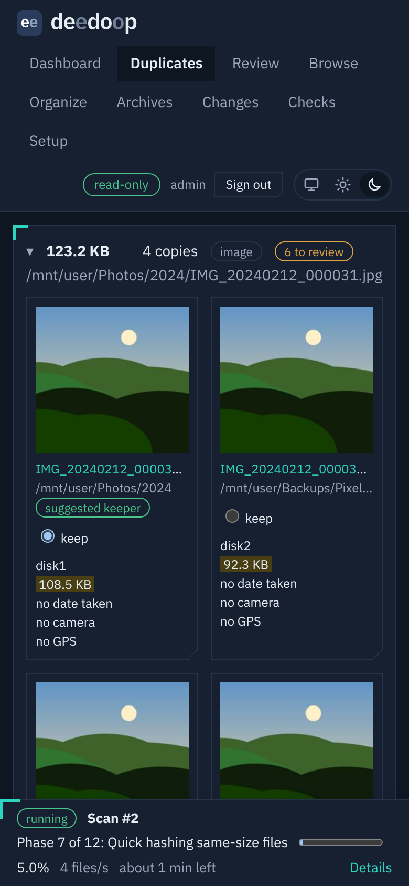

<h1>
  <picture>
    <source media="(prefers-color-scheme: dark)" srcset="docs/images/deedoop-wordmark-dark.svg">
    
  </picture>
</h1>

**Dedupe your hoard, safely.**

deedoop finds the duplicates other tools miss on your Unraid server: identical files with different names, photos that differ only in their metadata, re-compressed copies, and the contents of Google Takeout zips you've already got on disk. It indexes your terabytes incrementally, one disk at a time, and shows you everything before touching a single file.

## Screenshots

  
  

  
  

## What it finds

- **Exact copies** of any file type, whatever their names, compared by content (BLAKE3).
- **The same photo with other metadata**: a date fix, GPS tag or keywords don't hide a copy.
- **Similar photos**: recompressed or resized copies such as Google "Storage saver", which you review.
- **The same song or video with other tags**, and **re-encoded copies** (FLAC to MP3, a video shrunk by a phone), which you review.
- **What's already on disk** from zip, tar and 7z archives and Google Takeout, read in place and never extracted.

It also lets you browse your shares with their metadata and organize files into new folders, with a preview first. Every feature is described in **[docs/features.md](docs/features.md)**.

## Safe by default

deedoop is **read-only** until you sign in as the admin, tick **Allow changes** in Setup, mount `/mnt` read-write and confirm each list of changes. Removals go to a quarantine with undo; permanent delete is opt-in. Signed out, deedoop can only be looked at, never changed. See [SECURITY.md](SECURITY.md).

## Install on Unraid

deedoop is not in Community Applications yet, and its image is private: install it from the template in this repo. **[docs/install-unraid.md](docs/install-unraid.md)** has every step, including signing the server in to `ghcr.io` with a read-only token, updating and removing. In short:

1. On github.com, create a **classic** personal access token with only the `read:packages` scope (fine-grained tokens do not work with ghcr.io; 90 days expiry is plenty).
2. In the Unraid terminal, `docker login ghcr.io` with your GitHub login and that token.
3. Still in the terminal, `docker pull ghcr.io/steverodrigue/deedoop:latest`.
4. Still in the terminal, copy [`unraid/deedoop.xml`](unraid/deedoop.xml) to `/boot/config/plugins/dockerMan/templates-user/my-deedoop.xml`.
5. In the web UI's Docker tab, click **Add Container**, pick **deedoop**, check the paths and click **Apply**.
6. Open the container's **Logs** and copy the setup code, then open `http://<server>:8080` (`https://` if you turned on HTTPS), enter the code and create the admin account. (Or set **Admin password (first run only)** in the template.)
7. Go to **Setup**, tick your shares, then start a scan from the **Dashboard**. The first scan reads every file once and can take many hours, even days, on a large array; it runs in the background and can be paused. Later scans only read new and changed files.

Paths, permissions, environment variables and HTTPS are in [docs/configuration.md](docs/configuration.md).

## Documentation

| | |
|---|---|
| [docs/install-unraid.md](docs/install-unraid.md) | Install, update and remove on Unraid |
| [docs/features.md](docs/features.md) | Everything deedoop does, screen by screen |
| [docs/configuration.md](docs/configuration.md) | Paths, permissions, environment variables, HTTPS, building the image |
| [docs/development.md](docs/development.md) | Running from source, local CI, code layout, screenshots |
| [docs/secure-coding.md](docs/secure-coding.md) | The secure coding rules (SC1 to SC10) |
| [CHANGELOG.md](CHANGELOG.md) | What changed in each version |
| [ROADMAP.md](ROADMAP.md) | What may come next |
| [SECURITY.md](SECURITY.md) | Security model and reporting a vulnerability |
| [CONTRIBUTING.md](CONTRIBUTING.md) | How to contribute |

## Licence

Apache License 2.0. See [LICENSE](LICENSE) and [NOTICE](NOTICE).
